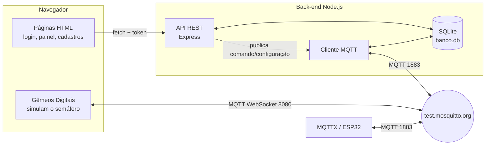

# Roteiro de testes — Semáforo Inteligente

Passo a passo para instalar, rodar e testar o projeto **em outra máquina** (Windows).
Cada teste diz o que fazer e o que deve acontecer. Tudo aqui foi testado em uma cópia limpa do repositório.

A [seção 11](#11-como-o-código-foi-feito-integração-do-back-end) explica todo o código que foi feito para integrar o back-end.

> Comandos para o **PowerShell** do Windows. No PowerShell 5.1 (o padrão) **não existe `&&`**:
> rode um comando por linha.

---

## 1. O que precisa estar instalado

| Programa | Versão | Para quê | Como conferir |
|---|---|---|---|
| **Node.js** | **22.13 ou maior** (recomendado: 24 LTS) | rodar o back-end e o banco SQLite embutido | `node --version` |
| **Git** | qualquer | baixar o projeto | `git --version` |
| **MQTTX** | qualquer | simular o semáforo (ESP32) pelo MQTT | abrir o programa |
| Navegador | Chrome, Edge ou Firefox | usar o sistema | — |

- Node: https://nodejs.org (baixe o instalador **LTS**).
- MQTTX: https://mqttx.app.
- **Não precisa instalar banco de dados nem Mosquitto.** O banco é o SQLite que já vem dentro do Node, e o broker é o público `test.mosquitto.org`.
- A máquina precisa de **internet**, porque o broker MQTT fica na internet.

---

## 2. Baixar e instalar

```powershell
git clone -b dev https://github.com/Brunotail1/ProjetoIntegrador_Semaforo.git
```

```powershell
cd ProjetoIntegrador_Semaforo\backend
```

```powershell
npm.cmd install
```

> Use `npm.cmd` em vez de `npm`. Em muitas máquinas o PowerShell bloqueia o `npm` com o erro
> *"a execução de scripts foi desabilitada neste sistema"*. O `npm.cmd` funciona sem mudar nenhuma configuração.

## 3. Testes automatizados

Ainda dentro de `backend`:

```powershell
npm.cmd test
```

**Esperado:** `tests 21`, `pass 21`, `fail 0`.
Os testes usam um banco em memória: não sujam o banco de verdade e não precisam de internet.

## 4. Subir o servidor

```powershell
npm.cmd start
```

**Esperado** no terminal:

```
Banco SQLite em C:\Users\<usuário>\.semaforo\banco.db
Aplicação em http://localhost:3000
Back-end conectado ao broker MQTT
```

- **Deixe esse terminal aberto** enquanto testa. Fechou o terminal, parou o servidor (`Ctrl+C` também para).
- Na primeira execução o banco é criado sozinho, com:
  - o usuário **admin@sistema.local / 123456**;
  - os semáforos **sem-a** e **sem-b** (tempos 5/3/5 s).

Abra no navegador: **http://localhost:3000**

---

## 5. Roteiro das telas (checklist)

Marque cada item conforme testar.

### 5.1 Login

- [ ] Abrir http://localhost:3000. Você é levado para a tela de **login**.
- [ ] Clicar em **Entrar** com os campos vazios → *"Preencha e-mail e senha."*
- [ ] Senha errada → *"E-mail ou senha incorretos."*
- [ ] `admin@sistema.local` / `123456` → abre o **Painel**.

### 5.2 Painel

- [ ] Mostra **2 Semáforos Cadastrados** e **1 Usuário Cadastrado** (num banco novo).
- [ ] "Status ao Vivo" fica vazio até chegar o primeiro estado (próximo passo).
- [ ] O painel se atualiza sozinho a cada 3 segundos.

### 5.3 Gêmeos Digitais

- [ ] Menu **Gêmeos Digitais** → aparecem os semáforos **sem-a** e **sem-b**, parados no **vermelho**.
- [ ] Clicar num semáforo → abre o detalhe com o **tópico MQTT de comando** e o exemplo de payload `{"cmd":"verde"}`.
- [ ] Bloco **Simulação Local**: os botões Vermelho / Amarelo / Verde / Intermitente / Automático mudam o semáforo simulado da tela. Esse bloco funciona até sem internet (RN06).

> **Importante:** os gêmeos **sem-a** e **sem-b** fazem o papel do semáforo físico. Eles só mudam de cor quando
> chega um comando pelo MQTT (MQTTX ou API), e são eles que respondem com o **estado**.
> Para o painel e o histórico receberem estados, **deixe a tela Gêmeos Digitais aberta numa aba**.

### 5.4 Cadastro de Semáforos (admin)

- [ ] **Novo Semáforo** com ID `sem-c`, nome `Semáforo C` e tempos 10 / 4 / 12 → aparece na tabela.
- [ ] Tentar criar outro com ID `sem-c` → *"Já existe um semáforo com o ID "sem-c"."*
- [ ] ID com espaço ou barra (ex.: `sem c`, `a/b`) → erro (o ID vira parte do tópico MQTT).
- [ ] Tempo `0` ou `61` → erro *"…deve ser entre 1 e 60 segundos"* (**RN05**).
- [ ] **Editar** o `sem-c` e mudar os tempos → no MQTTX chega a mensagem em `.../sem-c/configuracao`.
- [ ] O `sem-c` aparece em **Gêmeos Digitais** e no Painel.
- [ ] **Excluir** o `sem-c` → some da tabela, dos gêmeos e do contador.

### 5.5 Cadastro de Usuários (admin)

- [ ] **Novo Usuário**: `Operador Teste`, `op@teste.com`, perfil **Operador**, senha `abcd` (2×) → aparece na tabela.
- [ ] Repetir o mesmo e-mail → *"Já existe um usuário com esse e-mail."*
- [ ] Senhas diferentes → *"As senhas não coincidem."*
- [ ] Senha com menos de 4 caracteres → erro.
- [ ] **Editar** e deixar a senha em branco → mantém a senha atual.
- [ ] Tentar **excluir o próprio admin** → *"Você não pode excluir seu próprio usuário."*
- [ ] Editar o admin e mudar o perfil para Operador → *"O sistema precisa de pelo menos um administrador."*

### 5.6 Perfil Operador

- [ ] Clicar em **Sair** (canto do menu) → volta ao login.
- [ ] Entrar com `op@teste.com` / `abcd`.
- [ ] No Painel, o botão de atalho **Usuários** (em Ações Rápidas) não aparece.
- [ ] Clicar em **Usuários** no menu do topo (ou abrir http://localhost:3000/usuarios.html) → volta para o Painel.
- [ ] Em **Semáforos**, o operador vê a lista, mas **sem** o botão Novo Semáforo e sem Editar/Excluir. A API também recusa com 403.
- [ ] **Sair** e entrar de novo como admin.

### 5.7 Console do back-end

- [ ] Logado, abrir **http://localhost:3000/console**.
- [ ] Mostra o status ao vivo do semáforo escolhido (`sem-a`) e as falhas recebidas.
- [ ] Preencher os tempos e clicar em **Enviar** → a configuração é publicada no MQTT (aparece no MQTTX).
- [ ] Sem estar logado, o console manda para o login.

---

## 6. Teste do MQTT com o MQTTX

### 6.1 Conexão

No MQTTX: **New Connection**:

| Campo | Valor |
|---|---|
| Name | `semaforo` (qualquer) |
| Host | `mqtt://` + `test.mosquitto.org` |
| Port | `1883` |
| Client ID | deixe o gerado |
| Usuário / senha | em branco |

Clique em **Connect**. Depois, **New Subscription** com o tópico:

```
aps1/semaforo/TURMA/EQUIPE/#
```

Isso mostra **tudo** o que os semáforos e o back-end trocam.

> Antes de publicar, deixe a tela **Gêmeos Digitais** aberta no navegador.
> No campo de publicar do MQTTX, escolha o formato **JSON**.
>
> **Cuidado ao digitar o payload:** o editor do MQTTX fecha `{` e `"` sozinho. Se você digitar o JSON inteiro,
> sobra um `"}` no final e aparece *"Publish message SyntaxError: Unexpected non-whitespace character after JSON"*.
> Apague o que sobrou depois do último `}`, ou **cole** o payload em vez de digitar.

### 6.2 Mensagens para testar

O tópico base é `aps1/semaforo/TURMA/EQUIPE/sem-a/`. Troque `sem-a` por `sem-b` para testar o outro.

| # | Publicar no tópico | Payload | O que deve acontecer |
|---|---|---|---|
| 1 | `.../sem-a/comando` | `{"cmd":"verde"}` | O gêmeo **sem-a fica verde** na tela. No MQTTX chega a resposta em `.../sem-a/estado` com `"estado":"GREEN"`. O Painel mostra *Semáforo A · Verde*. |
| 2 | `.../sem-a/comando` | `{"cmd":"amarelo"}` / `{"cmd":"vermelho"}` | O gêmeo muda para a cor pedida e fica parado nela. |
| 3 | `.../sem-a/comando` | `{"cmd":"automatico"}` | O gêmeo volta a ciclar sozinho: vermelho → verde → amarelo. |
| 4 | `.../sem-a/comando` | `{"cmd":"intermitente"}` | O gêmeo fica **amarelo piscando** (modo de segurança). |
| 5 | `.../sem-a/configuracao` | `{"vermelho":10,"amarelo":3,"verde":8}` | Na tela **Semáforos**, o sem-a passa a mostrar **10 / 3 / 8**, e o gêmeo usa os novos tempos. |
| 6 | `.../sem-a/configuracao` | `{"vermelho":999,"amarelo":0,"verde":8}` | Valores fora da faixa são **limitados**: o cadastro fica **60 / 1 / 8** (**RN05**). |
| 7 | `.../sem-a/falha` | `{"luz":"vermelho"}` | A falha é gravada no banco e aparece no `/console`. O gêmeo entra em **intermitente** e publica `"estado":"BLINK_YELLOW"`. |
| 8 | `.../sem-a/estado` | `{"estado":"GREEN"}` | Gravado como último estado do sem-a: aparece no Painel e no `/console`. |

Depois do teste 6, volte os tempos ao normal: tela **Semáforos** → Editar sem-a → 5 / 3 / 5.

### 6.3 Do sistema para o MQTTX

| Ação no sistema | O que chega no MQTTX |
|---|---|
| Editar os tempos de um semáforo na tela **Semáforos** | `.../<id>/configuracao` com `{"vermelho":…,"amarelo":…,"verde":…,"origem":"backend"}` |
| **Enviar** no `/console` | o mesmo, em `.../<id>/configuracao` |
| Comando pela API (seção 7) | `.../<id>/comando` com `{"cmd":"…","origem":"backend"}` |
| Gêmeos Digitais aberto | `.../<id>/sincronizacao` a cada ~5 s (`{"status":"ok"}`) e `.../<id>/estado` a cada troca de cor |

O campo `"origem":"backend"` serve para o back-end não gravar em dobro o que ele mesmo publicou.

### 6.4 Histórico de comandos (RN07)

Todo comando e configuração, venha do MQTTX (`origem: MQTT`) ou da API (`origem: API`, com o e-mail de quem enviou), fica no banco.
Para ver, use a API da seção 7 (`/comandos`).

---

## 7. Teste da API pelo PowerShell (opcional)

Com o servidor rodando, em **outro** terminal:

```powershell
$s = Invoke-RestMethod -Method Post http://localhost:3000/login -ContentType 'application/json' -Body '{"email":"admin@sistema.local","senha":"123456"}'
$h = @{ Authorization = "Bearer $($s.token)" }
```

```powershell
# Mandar o sem-a ficar verde (o gêmeo precisa estar aberto para responder)
Invoke-RestMethod -Method Post http://localhost:3000/semaforos/sem-a/comando -Headers $h -ContentType 'application/json' -Body '{"cmd":"verde"}'
```

```powershell
# Mudar os tempos (só admin)
Invoke-RestMethod -Method Post http://localhost:3000/semaforos/sem-a/configuracao -Headers $h -ContentType 'application/json' -Body '{"vermelho":5,"amarelo":3,"verde":5}'
```

```powershell
# Último estado e falhas do sem-a
Invoke-RestMethod http://localhost:3000/semaforos/sem-a/status -Headers $h | ConvertTo-Json -Depth 4
```

```powershell
# Histórico de comandos (RN07)
Invoke-RestMethod "http://localhost:3000/comandos?dispositivo=sem-a&limite=10" -Headers $h | Format-Table
```

```powershell
# Dados do painel
Invoke-RestMethod http://localhost:3000/painel -Headers $h | ConvertTo-Json -Depth 4
```

Respostas esperadas:

| Situação | Código |
|---|---|
| Deu certo | `200` (`{"enviado":true,...}`) |
| Dado inválido (ex.: tempo 0, comando `azul`) | `400` com a mensagem de erro |
| Sem login / token vencido / depois do logout | `401` |
| Operador tentando ação de admin | `403` |
| Comando com o broker fora do ar | `503` *"Broker MQTT indisponível. O comando não foi enviado."* |
| Configuração com o broker fora do ar | `202` `{"enviado":false}`: salva no banco, mas não chega no semáforo |

A lista completa de rotas está em [`backend/README.md`](backend/README.md).

---

## 8. Usando o Live Server do VS Code (opcional)

O front-end também abre pelo **Live Server** (ex.: `http://127.0.0.1:5500/login.html`). Testado e funcionando.

- O **back-end precisa estar rodando** na porta 3000 (`npm.cmd start`), porque é ele que tem a API e o banco.
- **Não** abra os arquivos `.html` direto com dois cliques (`file:///...`). Nesse caso o navegador bloqueia a API e o login falha.
  Use `http://localhost:3000` ou o Live Server.

---

## 9. Problemas comuns

| Sintoma | Causa | Solução |
|---|---|---|
| *"Não foi possível conectar ao servidor. Verifique se o back-end está rodando."* | servidor parado, ou página aberta por `file:///` | Rodar `npm.cmd start` na pasta `backend` e abrir **http://localhost:3000** |
| `npm : ... a execução de scripts foi desabilitada` | política do PowerShell | Usar `npm.cmd install` / `npm.cmd start` |
| `O token '&&' não é um separador de instruções válido` | PowerShell 5.1 não tem `&&` | Rodar um comando por linha: `cd backend`, depois `npm.cmd start` |
| `Cannot find module 'express'` | faltou instalar dependências, ou terminal na pasta errada | Entrar em `backend` e rodar `npm.cmd install` |
| `No such built-in module: node:sqlite` ou erro de versão | Node antigo | Instalar o Node **22.13+** (de preferência 24 LTS) e abrir um **novo** terminal |
| *"A porta 3000 já está em uso"* | outro servidor já aberto (em outro terminal ou no VS Code) | Fechar o outro servidor (`Ctrl+C` no terminal dele). Se não achar: `Stop-Process -Id (Get-NetTCPConnection -LocalPort 3000 -State Listen).OwningProcess`. Não troque a porta: o front-end procura a API sempre na 3000 |
| Terminal mostra `Erro no MQTT: ...` repetido; gêmeos não respondem | sem internet, firewall/rede da escola bloqueando a porta 1883/8080, ou `test.mosquitto.org` fora do ar | Testar outra rede (ex.: 4G do celular). O resto do sistema (login, cadastros, painel) continua funcionando |
| Comando enviado, mas o estado não muda no Painel | a tela **Gêmeos Digitais** não está aberta | Abrir Gêmeos Digitais numa aba e mandar o comando de novo |
| Quero começar do zero (banco limpo) | — | Parar o servidor e apagar `%USERPROFILE%\.semaforo\banco.db`. Na próxima execução ele é recriado com o admin e o sem-a/sem-b |

> O `test.mosquitto.org` é um broker **público e gratuito**: às vezes fica lento ou cai por alguns minutos, e qualquer
> pessoa pode ver as mensagens. Se ele cair, espere um pouco e reinicie o servidor.

---

## 10. Resumo rápido (para quem já conhece)

```powershell
git clone -b dev https://github.com/Brunotail1/ProjetoIntegrador_Semaforo.git
cd ProjetoIntegrador_Semaforo\backend
npm.cmd install
npm.cmd test
npm.cmd start
```

Abrir http://localhost:3000 → `admin@sistema.local` / `123456` → abrir **Gêmeos Digitais** →
no MQTTX (`test.mosquitto.org:1883`) publicar `{"cmd":"verde"}` em `aps1/semaforo/TURMA/EQUIPE/sem-a/comando`
→ o gêmeo fica verde e o Painel mostra *Verde*.

---

## 11. Como o código foi feito (integração do back-end)

### 11.1 Antes e depois

| | Antes | Depois |
|---|---|---|
| Usuários e semáforos | ficavam no `localStorage` do navegador (cada navegador tinha os seus) | ficam no **banco SQLite**, acessado pela **API** do back-end |
| Senhas | guardadas em texto puro no navegador | guardadas como **hash scrypt** no banco |
| Login | conferido no próprio navegador | conferido no **servidor**, que devolve um **token** de sessão |
| Painel "Status ao Vivo" | lia o `sessionStorage` (só mostrava o que a própria aba tinha visto) | lê o **último estado gravado no banco**, vindo do MQTT |
| Back-end | um único `server.js` com só 2 rotas (enviar configuração e ver status) e gravação de estado e falha; sem login, sem cadastros, sem testes | organizado em módulos: API REST completa + MQTT + banco + autenticação + 21 testes |

### 11.2 Visão geral



- As **páginas** falam com o back-end por HTTP, usando a API.
- O **back-end** e os **gêmeos** falam entre si pelo **broker MQTT**. Nenhum dos dois chama o outro diretamente.
- O MQTTX (ou um ESP32 de verdade) entra no mesmo broker e conversa com os dois.

### 11.3 Estrutura de pastas do back-end

```
backend/
├── server.js              ponto de entrada: conecta no MQTT e sobe a API na porta 3000
├── package.json           dependências (express, mqtt) e os scripts start/test
├── public/index.html      tela /console (teste do MQTT pelo navegador)
├── test/api.test.js       21 testes automáticos
└── src/
    ├── config.js          configurações (porta, banco, broker, limites da RN05)
    ├── banco.js           abre o SQLite, cria as tabelas e os dados iniciais
    ├── senhas.js          hash e conferência de senha (scrypt)
    ├── autenticacao.js    sessões (token) e os filtros exigirLogin / exigirAdmin
    ├── usuarios.js        regras e consultas SQL de usuários
    ├── semaforos.js       regras e consultas SQL de semáforos
    ├── registros.js       histórico: estados, falhas e comandos (RN07)
    ├── mqtt.js            conexão com o broker, recebe e publica mensagens
    ├── app.js             monta o Express: CORS, rotas, páginas, erros
    └── rotas/
        ├── sessao.js      /login, /logout, /sessao
        ├── usuarios.js    /usuarios (só admin)
        ├── semaforos.js   /semaforos (+ comando, configuração, status)
        └── painel.js      /painel e /comandos
```

A ideia é **cada arquivo ter uma responsabilidade só**:

- Os arquivos de `rotas/` só recebem a requisição, chamam as regras e devolvem a resposta.
- As regras e o SQL ficam em `usuarios.js`, `semaforos.js` e `registros.js`.

### 11.4 Arquivo por arquivo

#### `server.js`: ponto de entrada

Mostra onde está o banco, chama `conectarMqtt()` e sobe o Express com `criarApp().listen(3000)`.
Se a porta já estiver ocupada, mostra uma mensagem clara em vez do erro técnico do Node.

#### `src/config.js`: configurações

Junta num lugar só os valores que podem mudar:

| Constante | Valor padrão | Variável de ambiente para trocar |
|---|---|---|
| `PORTA` | `3000` | `PORTA` |
| `CAMINHO_BANCO` | `%USERPROFILE%\.semaforo\banco.db` | `BANCO_DB` |
| `URL_MQTT` | `mqtt://test.mosquitto.org:1883` | `MQTT_URL` |
| `BASE_MQTT` | `aps1/semaforo/TURMA/EQUIPE` | `TURMA`, `EQUIPE` |
| `DURACAO_SESSAO_MS` | 8 horas | — |
| `TEMPO_MINIMO` / `TEMPO_MAXIMO` | 1 s / 60 s (RN05) | — |

O banco fica **fora da pasta do projeto** de propósito. Dentro dela, o Live Server recarregava a página toda vez que o banco era gravado.

#### `src/banco.js`: banco de dados

- Usa o **`node:sqlite`**, que já vem dentro do Node 22.13+. Por isso não precisa instalar nenhum banco.
- Cria as tabelas com `CREATE TABLE IF NOT EXISTS`. Se o banco já existe, nada se perde.
- Liga as chaves estrangeiras (`PRAGMA foreign_keys = ON`).
- Cria índices nas tabelas de histórico, para buscar rápido "o último estado do sem-a".
- **Dados iniciais** (admin, sem-a e sem-b) entram **uma vez só**. O banco guarda que isso já rodou no `PRAGMA user_version`. Assim, se alguém excluir o sem-a, ele não volta sozinho no próximo start.

Tabelas:

| Tabela | Guarda | Detalhes |
|---|---|---|
| `usuarios` | id (UUID), nome, e-mail, hash da senha, perfil | e-mail único sem diferenciar maiúsculas; perfil só `admin` ou `operador` (`CHECK`) |
| `sessoes` | hash do token, usuário, validade | `ON DELETE CASCADE`: excluir o usuário apaga as sessões dele |
| `semaforos` | id, nome, localização, turma, equipe, 3 tempos | o id é o mesmo usado no tópico MQTT |
| `estados` | cada estado recebido do semáforo | payload original em JSON + data |
| `falhas` | cada falha de luz recebida | payload original em JSON + data |
| `comandos` | histórico de comandos e configurações (**RN07**) | guarda o **e-mail** (não a chave do usuário), para o histórico continuar valendo depois que o usuário for excluído |

#### `src/senhas.js`: senhas

- `gerarHashDeSenha(senha)` gera um **sal aleatório** e calcula o hash com **scrypt**. Salva no formato `scrypt$<sal>$<hash>`.
- `senhaConfere(senha, armazenado)` recalcula o hash com o mesmo sal e compara usando `timingSafeEqual`. Essa comparação leva sempre o mesmo tempo, então ninguém descobre a senha medindo quanto a resposta demora.
- A senha **nunca** é guardada nem devolvida em texto.

#### `src/autenticacao.js`: login e permissões

- `abrirSessao(idUsuario)` gera um **token aleatório** de 32 bytes, que vai para o navegador. No banco fica só o **hash SHA-256** do token, válido por 8 h. Quem copiar o arquivo do banco não consegue usar as sessões. A cada login, as sessões vencidas são apagadas.
- `encerrarSessao(token)` apaga a sessão. É o logout.
- `exigirLogin` é um *middleware* do Express (filtro que roda antes da rota):
  1. Lê o cabeçalho `Authorization: Bearer <token>`.
  2. Procura a sessão no banco.
  3. Coloca o usuário em `req.usuario`, ou responde **401**.
- `exigirAdmin` responde **403** se o usuário não for admin.
- O perfil é lido do banco **a cada requisição**. Se o admin rebaixar alguém, a mudança vale na hora.

#### `src/usuarios.js`: regras de usuários

- `validar()` confere:
  - nome obrigatório, até 60 caracteres;
  - e-mail válido, até 80 caracteres;
  - perfil `admin` ou `operador`;
  - senha de 4 a 64 caracteres, obrigatória só no cadastro novo.
- `emailEmUso()` impede e-mail repetido.
- `atualizar()`:
  - com a **senha em branco**, mantém a senha atual;
  - com uma **senha nova**, derruba as sessões abertas daquele usuário.
- `paraJson()` monta o que vai para a tela **sem o hash da senha**.

#### `src/semaforos.js`: regras de semáforos

- `validarId()` aceita só letras, números, `-` e `_`, até 30 caracteres. O id vira parte do tópico MQTT, onde `/`, `+` e `#` têm significado especial e quebrariam os tópicos.
- `validarTempos()` aplica a **RN05**: cada tempo entre 1 e 60 s.
- `validarDados()` confere nome, localização, turma e equipe, e chama `validarTempos()`.
- `paraJson()` converte as colunas do banco (`tempo_vermelho`) para os nomes usados no front (`tempoVermelho`).
- `statusAoVivo()` é uma consulta SQL que junta cada semáforo com o **último estado** dele e calcula há quantos segundos chegou. Alimenta o Painel.

#### `src/registros.js`: histórico

- `registrarEstado()` e `registrarFalha()` gravam o que chega pelo MQTT.
- `registrarComando()` grava cada comando e configuração (**RN07**), com:
  - origem: `API` ou `MQTT`;
  - resultado: `OK`, `NAO_ENVIADO` ou `IGNORADO`;
  - o e-mail de quem mandou.
- `listarComandos()` devolve o histórico: 100 por padrão, no máximo 500, com filtro por semáforo opcional.
- `statusDoDispositivo()` devolve o último estado e as últimas 100 falhas.

#### `src/mqtt.js`: integração com o broker

- `conectarMqtt()`:
  - Conecta no broker.
  - Assina, para **todos** os semáforos (o `+` é o curinga do MQTT):
    `aps1/semaforo/TURMA/EQUIPE/+/estado`, `/+/falha`, `/+/comando` e `/+/configuracao`.
  - Usa `queueQoSZero: false`. Sem isso, um comando dado com o broker fora do ar seria entregue atrasado quando ele voltasse.
- `processarMensagem(topico, mensagem)`:
  1. Tira o **id do semáforo** e o **tipo** (sufixo) do tópico.
  2. Tenta ler o JSON. Para comando, também aceita texto puro (ex.: `verde`).
  3. **Ignora o próprio eco:** tudo que o back-end publica leva `"origem":"backend"`. Quando a mensagem volta do broker, ele reconhece e não grava em dobro.
  4. Conforme o tipo:

     | Sufixo | O que faz |
     |---|---|
     | `estado` | grava em `estados` |
     | `falha` | grava em `falhas` |
     | `comando` | registra no histórico como `origem: MQTT` |
     | `configuracao` | limita os tempos à RN05, salva no cadastro e registra no histórico. Tempo que não veio na mensagem mantém o valor atual. |

  5. Qualquer erro do banco é mostrado no console, sem derrubar o servidor.
- `publicar(id, sufixo, payload)` publica com `"origem":"backend"`. Devolve `false` se o broker estiver fora, e quem chamou decide o que responder.

#### `src/app.js`: montagem do servidor

- **CORS:** libera a API só para páginas da própria máquina (`localhost` ou `127.0.0.1`, qualquer porta). É isso que faz o Live Server (porta 5500) funcionar. Um site de fora não consegue chamar a API.
- Liga as rotas: sessão, painel, `/usuarios` e `/semaforos`.
- Serve **só** as 5 páginas HTML, `/assets`, `/images` e `/console`. Servir a pasta inteira exporia o `backend/` e o `.git`.
- Rota que não existe → **404** em JSON.
- JSON malformado → **400**.
- Erro inesperado → **500**, sem derrubar o servidor.

#### `src/rotas/*`: a API

| Método e rota | Quem pode | O que faz |
|---|---|---|
| `POST /login` | qualquer um | confere e-mail e senha; devolve o usuário + token |
| `POST /logout` | logado | apaga a sessão |
| `GET /sessao` | logado | devolve o usuário do token |
| `GET /painel` | logado | totais de semáforos e usuários + status ao vivo |
| `GET /comandos?dispositivo=&limite=` | logado | histórico de comandos (RN07) |
| `GET /usuarios` | admin | lista os usuários |
| `POST /usuarios` | admin | cria um usuário |
| `PUT /usuarios/:id` | admin | edita; bloqueia rebaixar o último admin |
| `DELETE /usuarios/:id` | admin | exclui; ninguém exclui a si mesmo |
| `GET /semaforos` | logado | lista os semáforos |
| `GET /semaforos/:id` | logado | um semáforo |
| `POST /semaforos` | admin | cria um semáforo |
| `PUT /semaforos/:id` | admin | edita; se os tempos mudaram, **publica a configuração no MQTT** |
| `DELETE /semaforos/:id` | admin | exclui; o histórico continua no banco |
| `POST /semaforos/:id/configuracao` | admin | valida (RN05), salva e publica os tempos; **202** se o broker estiver fora |
| `POST /semaforos/:id/comando` | logado | publica `{"cmd":"..."}`; **503** se o broker estiver fora |
| `GET /semaforos/:id/status` | logado | último estado + falhas recebidas |

Por que comando e configuração tratam o broker fora do ar de jeitos diferentes:

- O **comando** só vale naquele momento. Por isso falha (503) em vez de ficar guardado.
- A **configuração** é salva no cadastro mesmo assim (202). O semáforo a recebe quando os tempos forem enviados de novo.

#### `test/api.test.js`: testes automáticos

21 testes com o `node:test`, que já vem no Node. Eles:

- usam um banco **em memória** (`BANCO_DB=':memory:'`), sem mexer no banco real;
- sobem a API numa porta livre;
- chamam `processarMensagem()` direto, simulando mensagens MQTT sem precisar de internet.

Cobrem:

- login, logout e token;
- senhas e tokens guardados só como hash;
- CRUD e validações de usuários e semáforos;
- RN05 e o id seguro para o tópico;
- permissões de operador e admin;
- comando e configuração, inclusive com o broker fora do ar (503);
- estado, falha, comando e configuração recebidos por MQTT, e o eco do próprio back-end sendo ignorado;
- CORS, as páginas servidas e o JSON malformado.

### 11.5 O que mudou no front-end

| Arquivo | Mudança |
|---|---|
| `assets/js/armazenamento.js` | **Reescrito.** Antes lia e gravava o `localStorage`; agora cada função faz `fetch` para a API (detalhes abaixo). |
| `assets/js/autenticacao.js` | `sair()` agora avisa o servidor (`POST /logout`) antes de voltar ao login. Se o servidor estiver fora, sai do mesmo jeito. |
| `assets/js/aplicacao.js` | Gêmeos (detalhes abaixo). |
| `login.html` | Chama `Armazenamento.entrar()` e guarda no `sessionStorage` o usuário + token devolvidos. Saiu o código que conferia a senha no navegador. |
| `index.html` (Painel) | Busca `/painel` a cada 3 s. "Há quanto tempo" aparece em s, min, h ou dias. |
| `usuarios.html` / `semaforos.html` | Usam as funções assíncronas (`await`) da API e mostram as mensagens de erro que vêm do servidor. O operador não vê os botões de editar. |
| `gemeos.html` | O clique no semáforo funciona mesmo nos semáforos desenhados depois que a API responde (*event delegation*). O nome no detalhe vem do próprio desenho. |
| `backend/public/index.html` (`/console`) | Usa o token da sessão e manda para o login se não houver. |

Detalhes de `armazenamento.js`:

- Todas as chamadas passam por `_requisitar()`, que:
  - coloca o cabeçalho `Authorization: Bearer <token>`;
  - transforma qualquer erro em uma mensagem pronta para mostrar na tela;
  - se o servidor responder **401** (sessão vencida), limpa a sessão e volta para o login.
- `URL_DA_API` é vazio quando a página vem da porta 3000. No Live Server (outra porta), usa `http://localhost:3000`.
- Funções: `entrar`, `sair`, `obterPainel`, `listarUsuarios`, `salvarUsuario`, `excluirUsuario`, `listarDispositivos`, `salvarDispositivo`, `excluirDispositivo`.

Detalhes de `aplicacao.js` (gêmeos):

- Os semáforos são carregados **da API** (`await Armazenamento.listarDispositivos()`). Se a API estiver fora do ar, os gêmeos rodam com os semáforos padrão (**RN06**).
- O nome do semáforo passa por `escaparHtml()` antes de entrar no HTML. Assim, um nome como `<script>` não vira código na página.
- Saiu o código que gravava o estado no `sessionStorage` e os tempos no `localStorage`. Agora o back-end recebe tudo pelo MQTT e guarda no banco.

### 11.6 Caminho de um comando, do começo ao fim

Exemplo: alguém publica `{"cmd":"verde"}` em `aps1/semaforo/TURMA/EQUIPE/sem-a/comando` (pelo MQTTX ou pela API).

1. O **broker** entrega a mensagem a todos que assinam o tópico: o back-end e a aba Gêmeos Digitais.
2. O **back-end** (`mqtt.js`) registra no histórico `comandos`: `cmd:verde`, origem `MQTT`.
   Se veio pela API, já registrou como origem `API` com o e-mail, e ignora o eco.
3. O **gêmeo** (`aplicacao.js`) muda o sem-a para verde e publica em `.../sem-a/estado`:
   `{"estado":"GREEN","origem":"gemeo-web",...}`
4. O **back-end** recebe esse estado e grava na tabela `estados`.
5. O **Painel**, que pergunta `/painel` a cada 3 s, lê o último estado do banco e mostra *Semáforo A · Verde*.

E no sentido contrário, ao editar os tempos:

1. Na tela **Semáforos**, o admin muda os tempos e salva → `PUT /semaforos/sem-a`.
2. O back-end valida (RN05), grava no banco e, como os tempos mudaram, publica `{"vermelho":..,"amarelo":..,"verde":..,"origem":"backend"}` em `.../sem-a/configuracao`.
3. O gêmeo (e o ESP32 ou o MQTTX) recebe e passa a usar os tempos novos.
4. O histórico registra `configurar`, origem `API`, com o e-mail do admin.

### 11.7 Segurança, em resumo

- Senhas com **scrypt + sal**. Tokens guardados só como **hash SHA-256**. Nada sensível volta para o navegador.
- Todas as rotas, menos o login, exigem token. As de cadastro exigem **admin**. A conferência acontece no **servidor**, não só escondendo botões na tela.
- Todas as consultas SQL usam `prepare` com `?`, o que evita **SQL injection**.
- Nomes são escapados antes de entrar no HTML, o que evita **XSS**.
- O **CORS** aceita só páginas da própria máquina.
- O servidor **não** entrega os arquivos internos (`backend/`, `.git`).
